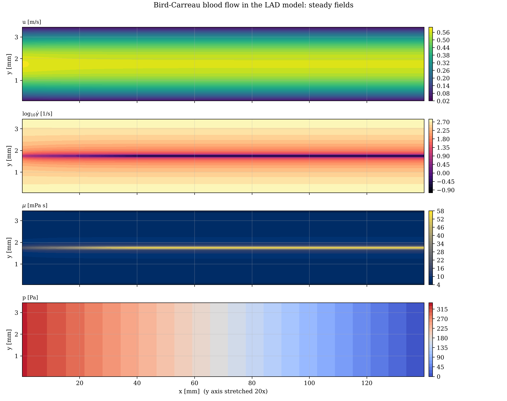

# GPU Finite-Volume Simulation of Non-Newtonian Blood Flow in the LAD Coronary Artery

**Course:** OE5450 Numerical Techniques in Ocean Hydrodynamics, IIT Madras, Jan–May 2025  
**Language:** CUDA C  
**Author:** Karthick J, Department of Ocean Engineering, IIT Madras



## Problem
Unsteady, incompressible flow of blood (shear-thinning Bird–Carreau fluid) through a 2-D model of the proximal left anterior descending (LAD) artery, 140 mm × 3.5 mm on a 1400 × 35 staggered grid.

## Method
- Projection method on a staggered (MAC) finite-volume grid, one CUDA kernel per stage
- QUICK convection, central diffusion with the local Carreau viscosity
- SOR pressure Poisson solver with an added block (additive) correction that enforces mass conservation along the 400:1 channel
- Adaptive time step from the combined convective–diffusive stability limit

## Key results
- Newtonian check: pressure gradient matches the exact discrete Poiseuille solution to 2.6 × 10⁻⁶
- Carreau case: developed velocity profile within 0.20 % of the exact (ODE) Carreau solution; pressure gradient within 0.07 %
- Entrance length 50.4 mm (14.4 channel widths); wall shear stress 4.20 Pa
- Block correction: flow rate held at exactly 1.0000 Q_in with 25 sweeps/step, against 0.96 Q_in with 1000 sweeps of plain SOR

## Video
- [`video/blood_flow_LAD_startup.mp4`](video/blood_flow_LAD_startup.mp4) – Start-up of the flow: velocity field and developing profiles as the flow becomes fully developed.

## Report
Full technical report with flowchart, code review, verification and validation: [`report/report.pdf`](report/report.pdf) (LaTeX source `report/report.tex`).

## Folder contents
| Folder / file | What it holds |
|---|---|
| `code/` | corrected source (`Blood_flow.cu`, `make_video.py`, `postprocess.py`); changes from the submitted version are marked `[FIX]`, `[ADDED]` or `[CHANGED]` |
| `original/` | code, report and notes exactly as submitted (unchanged) |
| `results/` | figures, `summary.txt` and raw outputs |
| `report/` | technical report (PDF and LaTeX) |
| `video/` | animations of the simulation |
| `run.sh` | rebuilds and reruns the project and regenerates the figures |
| `make_video.sh` | reruns with frequent output and rebuilds the videos (needs ffmpeg) |

## How to run
```bash
bash run.sh          # build, run and post-process
bash make_video.sh   # regenerate the videos
```

On a machine with `nvcc` and an NVIDIA GPU the CUDA kernels run on the GPU (`bash run.sh gpu`). Without a GPU, `tools/emulate.sh` runs the same kernels serially on the CPU; this is how the stored results and videos were produced.
