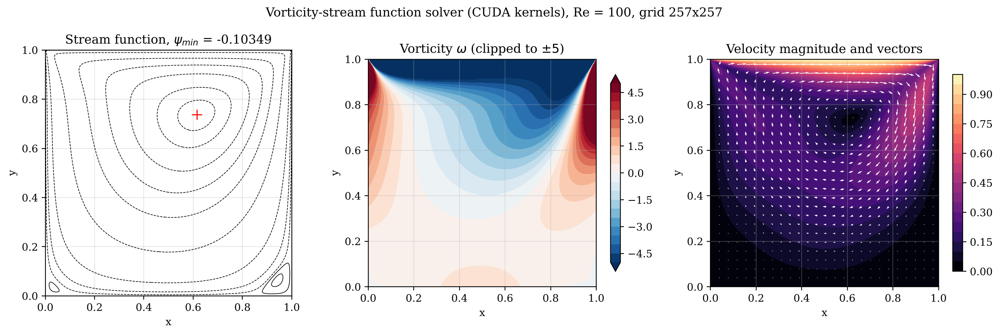

# GPU Vorticity–Stream Function Solver for the Lid-Driven Cavity (Re = 100)

**Course:** OE5450 Numerical Techniques in Ocean Hydrodynamics, IIT Madras, Jan–May 2025  
**Language:** CUDA C  
**Author:** Karthick J, Department of Ocean Engineering, IIT Madras



## Problem
Steady flow in a square cavity driven by a sliding lid at Re = 100, computed with an explicit vorticity–stream function finite-difference method on the GPU.

## Method
- Vorticity transport (explicit) and stream-function Poisson equation, each a CUDA kernel
- Thom boundary condition for wall vorticity
- Red–black Gauss–Seidel / SOR for the stream function
- Three-grid study (129², 257², 401²) with Richardson extrapolation and GCI

## Key results
- ψ_min = −0.10350 at (0.6158, 0.7369) on the 401² grid; Ghia et al. (1982): −0.10342
- Observed order of accuracy 2.01–2.02; GCI below 0.05 %
- Both secondary corner eddies resolved

## Video
- [`video/cuda_cavity_vorticity_streamfunction.mp4`](video/cuda_cavity_vorticity_streamfunction.mp4) – Vorticity and stream function from rest to steady state.

## Report
Full technical report with flowchart, code review, verification and validation: [`report/report.pdf`](report/report.pdf) (LaTeX source `report/report.tex`).

## Folder contents
| Folder / file | What it holds |
|---|---|
| `code/` | corrected source (`Lid_driven_Cavity.cu`, `make_video.py`, `postprocess.py`); changes from the submitted version are marked `[FIX]`, `[ADDED]` or `[CHANGED]` |
| `original/` | code, report and notes exactly as submitted (unchanged) |
| `results/` | figures, `summary.txt` and raw outputs |
| `report/` | technical report (PDF and LaTeX) |
| `video/` | animations of the simulation |
| `run.sh` | rebuilds and reruns the project and regenerates the figures |
| `make_video.sh` | reruns with frequent output and rebuilds the videos (needs ffmpeg) |

## How to run
```bash
bash run.sh          # build, run and post-process
bash make_video.sh   # regenerate the videos
```

On a machine with `nvcc` and an NVIDIA GPU the CUDA kernels run on the GPU (`bash run.sh gpu`). Without a GPU, `tools/emulate.sh` runs the same kernels serially on the CPU; this is how the stored results and videos were produced.
