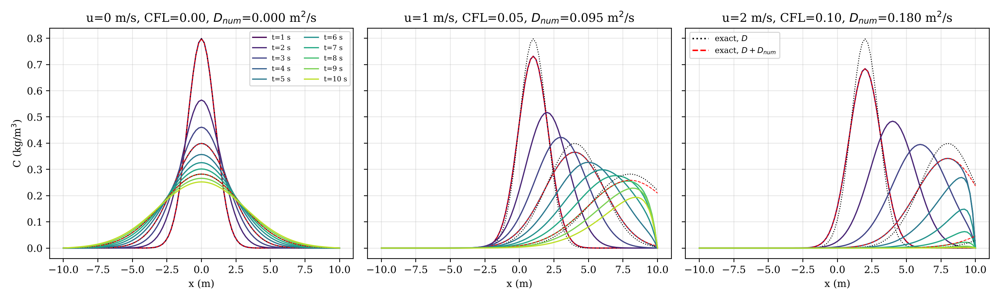

# 1-D Advection–Diffusion of a Dye Release

**Course:** OE5450 Numerical Techniques in Ocean Hydrodynamics, IIT Madras, Jan–May 2025  
**Language:** C  
**Author:** Karthick J, Department of Ocean Engineering, IIT Madras



## Problem
Transport of an instantaneous dye release (C₀ = 10 kg/m³ at one node) in a uniform stream, u = 0, 1, 1.5 and 2 m/s, with D = 0.5 m²/s.

## Method
- Explicit forward-Euler time stepping, upwind (FTBS) advection, central diffusion
- Comparison with the exact Gaussian solution
- Numerical diffusion measured from the spreading of the cloud (variance) and compared with modified-equation theory

## Key results
- Effective diffusivity from the computed variance agrees with D + D_num from the modified equation (e.g. 0.5927 vs 0.5950 m²/s at u = 1 m/s)
- Cloud centroid moves at the stream speed to within 0.1 %
- At u = 0 the computed peak matches the exact solution (L2 error 5 × 10⁻⁵)

## Video
- [`video/advection_diffusion_u0_1_1.5_2.mp4`](video/advection_diffusion_u0_1_1.5_2.mp4) – Concentration profiles for the four stream speeds, compared with the exact solution, step by step.

## Report
Full technical report with flowchart, code review, verification and validation: [`report/report.pdf`](report/report.pdf) (LaTeX source `report/report.tex`).

## Folder contents
| Folder / file | What it holds |
|---|---|
| `code/` | corrected source (`advection_diffusion.c`, `make_video.py`, `postprocess.py`); changes from the submitted version are marked `[FIX]`, `[ADDED]` or `[CHANGED]` |
| `original/` | code, report and notes exactly as submitted (unchanged) |
| `results/` | figures, `summary.txt` and raw outputs |
| `report/` | technical report (PDF and LaTeX) |
| `video/` | animations of the simulation |
| `run.sh` | rebuilds and reruns the project and regenerates the figures |
| `make_video.sh` | reruns with frequent output and rebuilds the videos (needs ffmpeg) |

## How to run
```bash
bash run.sh          # build, run and post-process
bash make_video.sh   # regenerate the videos
```
