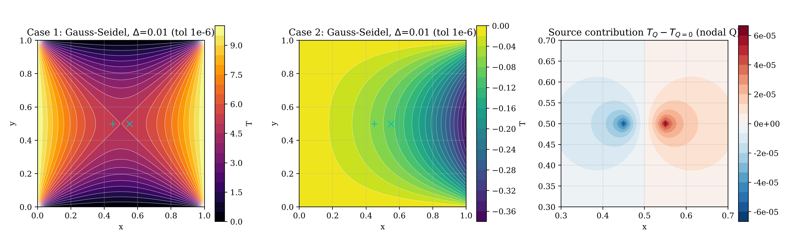

# 2-D Poisson Equation: Jacobi, Gauss–Seidel and Successive Under-Relaxation

**Course:** OE5450 Numerical Techniques in Ocean Hydrodynamics, IIT Madras, Jan–May 2025  
**Language:** C  
**Author:** Karthick J, Department of Ocean Engineering, IIT Madras



## Problem
Poisson equation ∇²T = Q with a two-node source/sink pair on the unit square, for two sets of boundary conditions and grid spacings 0.1, 0.05 and 0.01.

## Method
- Point Jacobi, Gauss–Seidel and successive under-relaxation (SUR)
- Comparison with a direct solve and with the analytical solution
- Iteration counts compared with the theoretical spectral radii (ρ_J = cos πΔ, ρ_GS = ρ_J²)

## Key results
- Gauss–Seidel needs about half the iterations of Jacobi, as theory predicts
- Termination error (iterative vs direct solution) quantified for tolerances 10⁻⁴ and 10⁻⁶
- Discretisation error falls with grid spacing as expected (3.0 × 10⁻² → 3.3 × 10⁻⁴)

## Video
- [`video/poisson_iterations_jacobi_gs_sur.mp4`](video/poisson_iterations_jacobi_gs_sur.mp4) – Temperature field iteration by iteration for Jacobi, Gauss–Seidel and SUR side by side.

## Report
Full technical report with flowchart, code review, verification and validation: [`report/report.pdf`](report/report.pdf) (LaTeX source `report/report.tex`).

## Folder contents
| Folder / file | What it holds |
|---|---|
| `code/` | corrected source (`gauss_seidel.c`, `jacobi.c`, `make_video.py`, `postprocess.py`, `sur.c`); changes from the submitted version are marked `[FIX]`, `[ADDED]` or `[CHANGED]` |
| `original/` | code, report and notes exactly as submitted (unchanged) |
| `results/` | figures, `summary.txt` and raw outputs |
| `report/` | technical report (PDF and LaTeX) |
| `video/` | animations of the simulation |
| `run.sh` | rebuilds and reruns the project and regenerates the figures |
| `make_video.sh` | reruns with frequent output and rebuilds the videos (needs ffmpeg) |

## How to run
```bash
bash run.sh          # build, run and post-process
bash make_video.sh   # regenerate the videos
```
