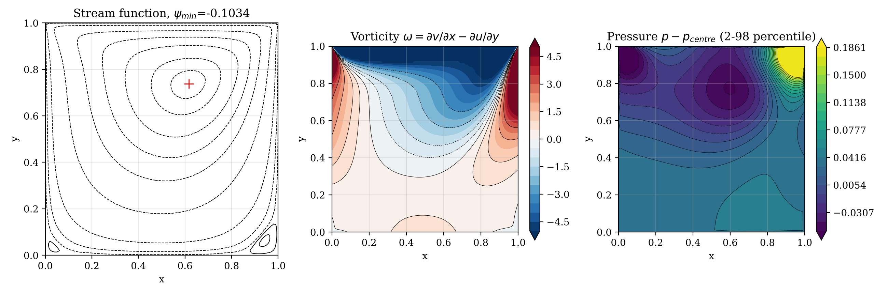

# Lid-Driven Cavity Flow with the SMAC Method (Re = 100)

**Course:** AM5630 Foundations of Computational Fluid Dynamics, IIT Madras, Jan–May 2024  
**Language:** C  
**Author:** Karthick J, Department of Ocean Engineering, IIT Madras



## Problem
Steady 2-D incompressible flow in a unit square cavity driven by a sliding lid at Re = 100, using primitive variables.

## Method
- Simplified Marker-And-Cell (SMAC) fractional-step method on a staggered grid
- Pressure-correction Poisson equation solved iteratively
- Grids 49 × 49 and 99 × 99; comparison with Ghia et al. (1982)

## Key results
- ψ_min = −0.10337 at (0.6162, 0.7374) on 99 × 99; Ghia: −0.10342 (0.05 %)
- Centreline velocities within 0.005 (u) and 0.009 (v) of Ghia
- Bottom-left and bottom-right corner eddies resolved

## Video
- [`video/smac_cavity_startup_to_steady.mp4`](video/smac_cavity_startup_to_steady.mp4) – Streamlines and vorticity from impulsive start to steady state.

## Report
Full technical report with flowchart, code review, verification and validation: [`report/report.pdf`](report/report.pdf) (LaTeX source `report/report.tex`).

## Folder contents
| Folder / file | What it holds |
|---|---|
| `code/` | corrected source (`make_video.py`, `postprocess.py`, `smac_cavity.c`); changes from the submitted version are marked `[FIX]`, `[ADDED]` or `[CHANGED]` |
| `original/` | code, report and notes exactly as submitted (unchanged) |
| `results/` | figures, `summary.txt` and raw outputs |
| `report/` | technical report (PDF and LaTeX) |
| `video/` | animations of the simulation |
| `run.sh` | rebuilds and reruns the project and regenerates the figures |
| `make_video.sh` | reruns with frequent output and rebuilds the videos (needs ffmpeg) |

## How to run
```bash
bash run.sh          # build, run and post-process
bash make_video.sh   # regenerate the videos
```
