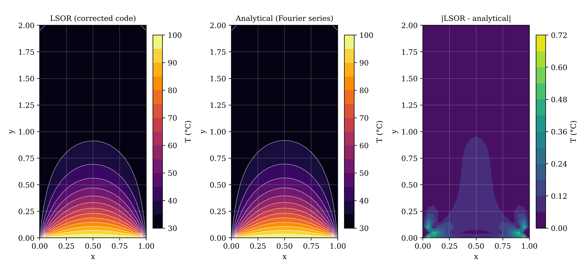

# 2-D Steady Heat Conduction: Six Iterative Solvers Compared

**Course:** AM5630 Foundations of Computational Fluid Dynamics, IIT Madras, Jul–Nov 2024  
**Language:** C  
**Author:** Karthick J, Department of Ocean Engineering, IIT Madras



## Problem
Steady temperature field in a 1 × 2 plate with a hot bottom wall (100 °C) and the other walls at 30 °C, on a 21 × 41 grid.

## Method
- Point Gauss–Seidel, line Gauss–Seidel, PSOR, LSOR, ADI and relaxed ADI
- Optimum relaxation factor measured by a sweep and compared with theory
- Heat balance across the boundaries and comparison with the analytical (series) solution

## Key results
- Iterations to converge: 296 (point GS) down to 37 (relaxed ADI)
- Measured optimum ω for PSOR = 1.75; theory ω_opt = 1.78
- Heat balance closes exactly with the corrected boundary-flux formula (in = out = 12 813.6 W)

## Video
- [`video/iterative_solvers_convergence.mp4`](video/iterative_solvers_convergence.mp4) – Temperature field and residual for all six solvers, iteration by iteration.

## Report
Full technical report with flowchart, code review, verification and validation: [`report/report.pdf`](report/report.pdf) (LaTeX source `report/report.tex`).

## Folder contents
| Folder / file | What it holds |
|---|---|
| `code/` | corrected source (`adi.c`, `adi_relaxation.c`, `line_gauss_seidel.c`, `lsor.c`, `make_video.py`, `point_gauss_seidel.c`, `postprocess.py`, `psor.c`); changes from the submitted version are marked `[FIX]`, `[ADDED]` or `[CHANGED]` |
| `original/` | code, report and notes exactly as submitted (unchanged) |
| `results/` | figures, `summary.txt` and raw outputs |
| `report/` | technical report (PDF and LaTeX) |
| `video/` | animations of the simulation |
| `run.sh` | rebuilds and reruns the project and regenerates the figures |
| `make_video.sh` | reruns with frequent output and rebuilds the videos (needs ffmpeg) |

## How to run
```bash
bash run.sh          # build, run and post-process
bash make_video.sh   # regenerate the videos
```
