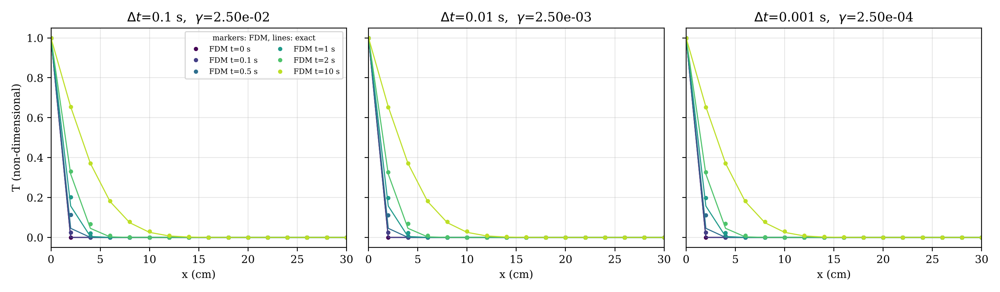

# 1-D Transient Heat Conduction in a Flat Plate: Explicit FTCS Scheme

**Course:** AM5630 Foundations of Computational Fluid Dynamics, IIT Madras, Jul–Nov 2024  
**Language:** C (MATLAB version included)  
**Author:** Karthick J, Department of Ocean Engineering, IIT Madras



## Problem
Transient temperature in a 1-D plate after a sudden step in wall temperature.

## Method
- Explicit forward-time, central-space (FTCS) finite differences
- Comparison with the exact series solution
- Time-step and grid studies; stability limit γ = αΔt/Δx² ≤ 1/2 demonstrated

## Key results
- Second-order convergence in space confirmed
- T(x = 2 cm, t = 10 s) = 0.6525 (exact 0.6547)
- With γ > 1/2 the solution blows up, as the von Neumann analysis predicts

## Video
- [`video/conduction_FTCS_dt0.1_every_step.mp4`](video/conduction_FTCS_dt0.1_every_step.mp4) – Stable run (Δt = 0.1 s): temperature profile at every time step against the exact solution.
- [`video/conduction_FTCS_dt2.5_instability.mp4`](video/conduction_FTCS_dt2.5_instability.mp4) – Unstable run (Δt = 2.5 s, γ > 1/2): growth of the oscillation that destroys the solution.

## Report
Full technical report with flowchart, code review, verification and validation: [`report/report.pdf`](report/report.pdf) (LaTeX source `report/report.tex`).

## Folder contents
| Folder / file | What it holds |
|---|---|
| `code/` | corrected source (`assignment_1.c`, `assignment_1_matlab.m`, `make_video.py`, `plot_results.py`, `study.py`); changes from the submitted version are marked `[FIX]`, `[ADDED]` or `[CHANGED]` |
| `original/` | code, report and notes exactly as submitted (unchanged) |
| `results/` | figures, `summary.txt` and raw outputs |
| `report/` | technical report (PDF and LaTeX) |
| `video/` | animations of the simulation |
| `run.sh` | rebuilds and reruns the project and regenerates the figures |
| `make_video.sh` | reruns with frequent output and rebuilds the videos (needs ffmpeg) |

## How to run
```bash
bash run.sh          # build, run and post-process
bash make_video.sh   # regenerate the videos
```
